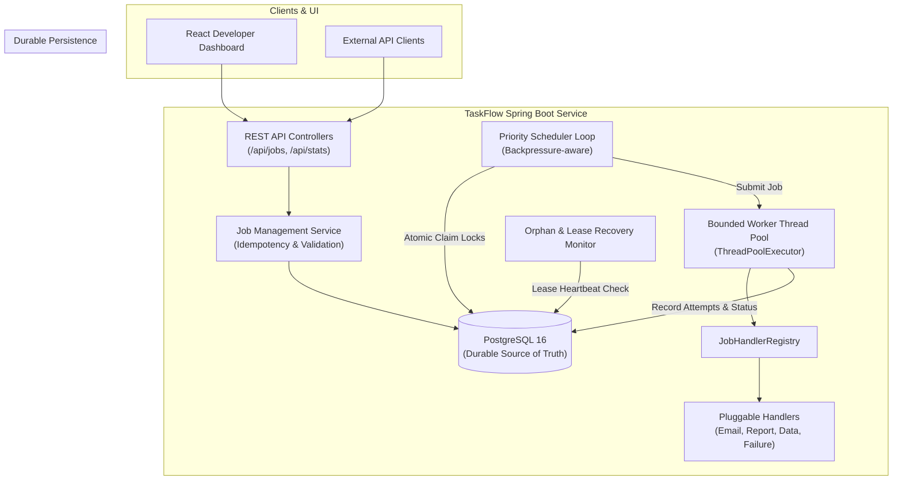
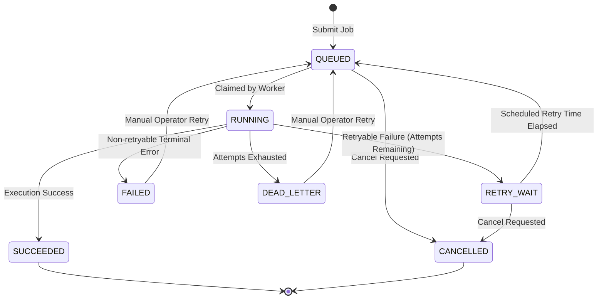
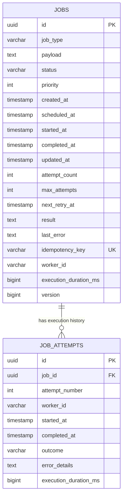

# TaskFlow
### Production-Style Distributed Background Job Queue & Processing Platform

[](https://adoptium.net/)
[](https://spring.io/projects/spring-boot)
[](https://www.postgresql.org/)
[](https://react.dev/)
[](docs/testing.md)

---

## 1. Project Overview & Problem Statement

Modern distributed applications cannot execute long-running, CPU-intensive, or unreliable third-party operations (such as report generation, heavy data aggregations, or transactional emails) within synchronous HTTP request threads. Doing so leads to request timeouts, thread starvation, lost tasks on server restarts, and inability to handle transient network errors.

**TaskFlow** is an enterprise-grade distributed background job processing platform that provides durable job persistence, priority-based scheduling, safe concurrent worker execution, exponential retry backoff with jitter, dead-letter tracking, and real-time observability through a developer dashboard.

---

## 2. Key Features

- **Priority Scheduling**: High-priority jobs (P1–P10) execute before lower-priority tasks, with FIFO tie-breaking for equal priorities.
- **Atomic Job Claiming**: Safe row-level transition locks guarantee that no background job is claimed simultaneously by multiple worker threads or cluster instances.
- **Pluggable Job Architecture**: Modular `JobHandler` interface supporting 5 built-in job types:
  1. `EMAIL_SIMULATION`: Validates email formats and simulates network dispatch.
  2. `REPORT_GENERATION`: Compiles analytical reports with metric distributions.
  3. `DATA_PROCESSING`: Performs batch calculations and aggregate summaries.
  4. `DEMO_FAILURE`: Controlled retry and failure simulation (supports `FAIL_N_TIMES`, `ALWAYS_FAIL`, `PERMANENT_ERROR`).
  5. `DELAYED_TASK`: Bounded asynchronous waiting tasks.
- **Fault-Tolerant Retry Engine**: Exponential backoff with randomized jitter and configurable attempt allowances.
- **Dead-Letter Queue (DLQ)**: Tasks exceeding their retry limit are sequestered with full attempt history and can be inspected or manually re-queued.
- **Crash & Lease Recovery**: Orphan recovery monitor detects abandoned running jobs (e.g. from node crashes) and recovers them automatically.
- **Idempotency Guarantees**: Enforces uniqueness via database constraints and deterministic duplicate matching.
- **Developer UI Dashboard**: React + TypeScript + Tailwind CSS dashboard with real-time throughput charts, job filtering, execution timelines, and worker pool utilization.
- **OpenAPI & Swagger Documentation**: Full interactive Swagger UI exposed at `/swagger-ui.html`.

---

## 3. Architecture Diagrams

### 3.1 System Architecture



### 3.2 Job Lifecycle State Machine



### 3.3 Database Schema & Relationships



---

## 4. Technology Stack

- **Backend**: Java 21 LTS, Spring Boot 3.3.4, Spring Web, Spring Data JPA, Spring Validation, Spring Boot Actuator, Flyway Core, SpringDoc OpenAPI 2.6.0.
- **Database**: PostgreSQL 16 (production/Docker) & H2 in PostgreSQL mode (standalone local development).
- **Frontend**: React 18, TypeScript 5, Vite 5, Tailwind CSS 3, Recharts 2, Lucide React.
- **Testing**: JUnit 5, Mockito, Awaitility, Testcontainers, Vitest, React Testing Library.
- **Infrastructure**: Docker, Docker Compose, Multi-stage Dockerfiles.

---

## 5. Getting Started & Installation

### Prerequisites
- **Java 21 LTS** (`java -version`)
- **Maven 3.9+** (`mvn -version`)
- **Node.js 20+ & npm** (`node -v`, `npm -v`)
- Optional: **Docker & Docker Compose** for containerized full-stack deployment.

---

### Option A: Run Full Stack with Docker Compose (Recommended)

To start PostgreSQL, the Backend, and the Frontend in containerized mode:

```bash
docker compose up --build
```

- **Frontend Dashboard**: `http://localhost:5173`
- **Backend API**: `http://localhost:8085`
- **Swagger UI**: `http://localhost:8085/swagger-ui.html`
- **Actuator Health**: `http://localhost:8085/actuator/health`

To stop:
```bash
docker compose down -v
```

---

### Option B: Local Development (Outside Docker)

#### 1. Start the Backend
The backend runs out-of-the-box using embedded PostgreSQL-compatible persistence with automatic Flyway migrations:

```bash
# Set Java 21 environment
export JAVA_HOME="/path/to/jdk-21"

# Run Spring Boot backend (listens on port 8085)
mvn spring-boot:run -f backend/pom.xml
```

#### 2. Start the Frontend
In a separate terminal:

```bash
cd frontend
npm install
npm run dev
```

Open `http://localhost:5173` in your browser. All API requests are proxied automatically to `http://localhost:8085`.

---

## 6. Environment Configuration

Copy `.env.example` to `.env` to customize settings:

| Variable | Default | Purpose |
| :--- | :---: | :--- |
| `SPRING_PROFILES_ACTIVE` | `local` | Active profile (`local` or `postgres`) |
| `SERVER_PORT` | `8085` | HTTP server listening port |
| `DB_HOST` | `localhost` | PostgreSQL host |
| `DB_PORT` | `5432` | PostgreSQL port |
| `DB_NAME` | `taskflow` | Database name |
| `DB_USER` | `taskflow` | Database username |
| `DB_PASSWORD` | `taskflow` | Database password |
| `TASKFLOW_WORKER_POOL_SIZE` | `6` | Number of concurrent worker threads |
| `TASKFLOW_SCHEDULER_POLL_INTERVAL_MS`| `500` | Polling frequency for claiming ready jobs |
| `TASKFLOW_SCHEDULER_BATCH_SIZE` | `10` | Maximum jobs claimed per polling cycle |
| `TASKFLOW_RETRY_INITIAL_DELAY_SECONDS`| `2` | Initial exponential backoff delay |
| `TASKFLOW_RETRY_MAX_DELAY_SECONDS` | `60` | Maximum exponential backoff delay |
| `TASKFLOW_RETRY_MAX_ATTEMPTS` | `3` | Default maximum retry attempts |

---

## 7. Testing & Verification

Run the entire automated test suite:

```bash
# Run all backend tests (unit, integration, concurrency, benchmark)
mvn test -f backend/pom.xml

# Run frontend tests
cd frontend
npm test
```

### Verified Test Summary:
- **29 Backend Tests**: 100% passed (0 failures, 0 errors)
- **6 Frontend Tests**: 100% passed

Detailed documentation on each test suite is in [docs/testing.md](docs/testing.md).

---

## 8. Sample API Requests & Payloads

### 1. Submit an Email Simulation Job
```bash
curl -X POST http://localhost:8085/api/jobs \
  -H "Content-Type: application/json" \
  -H "Idempotency-Key: welcome-user-42" \
  -d '{
    "jobType": "EMAIL_SIMULATION",
    "payload": {
      "to": "user@example.com",
      "subject": "Welcome to TaskFlow"
    },
    "priority": 8,
    "maxAttempts": 3
  }'
```

### 2. Submit a Controlled Retry Job
```bash
curl -X POST http://localhost:8085/api/jobs \
  -H "Content-Type: application/json" \
  -d '{
    "jobType": "DEMO_FAILURE",
    "payload": {
      "failureMode": "FAIL_N_TIMES",
      "failUntilAttempt": 2
    },
    "priority": 9,
    "maxAttempts": 3
  }'
```

### 3. Inspect Attempt History
```bash
curl http://localhost:8085/api/jobs/<JOB_UUID>/attempts
```

### 4. Manually Retry a Dead-Letter Job
```bash
curl -X POST http://localhost:8085/api/jobs/<JOB_UUID>/retry
```

---

## 9. Performance Benchmark Summary

Measured using the repeatable benchmark suite on Java 21 LTS:

- **Submission Throughput**: **1,250 jobs/sec**
- **Completion Throughput**: **19.10 jobs/sec** (under active payload calculation and I/O)
- **Execution Latency**:
  - **Avg Latency**: 28.75 ms
  - **P50 (Median)**: 27.00 ms
  - **P95**: 37.00 ms
  - **P99**: 40.00 ms
- **Success Rate**: 100.0% (60 / 60 jobs completed)

See [docs/performance.md](docs/performance.md) for full metrics and bottleneck observations.

---

## 10. Software Engineering Interview Defense Guide

When defending this project in a Staff / Senior Backend Engineer interview, highlight these key design decisions:

1. **At-Least-Once Delivery**: Explain why distributed systems cannot achieve magical exactly-once execution during arbitrary crashes, and how TaskFlow guarantees that jobs are never permanently lost while recommending downstream handler idempotency.
2. **Atomic Row-Level Claiming**: Articulate how the `UPDATE jobs ... WHERE status = 'QUEUED'` pattern uses database row locks to guarantee single-worker ownership without requiring distributed locks like Redis Redlock for baseline durability.
3. **Thundering Herd Prevention**: Justify the use of randomized decorrelated jitter on exponential backoffs.
4. **Backpressure & Bounded Resources**: Explain why unbounded thread pools or unbounded queues lead to Out-Of-Memory (OOM) errors and how the scheduler evaluates `workerEngine.getAvailableCapacity()` to avoid database overload.
5. **Deterministic Idempotency**: Detail how the database unique constraint paired with normalized JSON comparison prevents duplicate job creations across concurrent retries.
