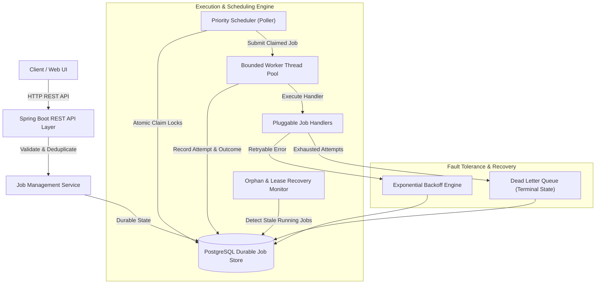

# TaskFlow Architecture & Distributed Systems Design

## 1. System Overview

**TaskFlow** is a production-grade distributed background job queue and asynchronous task execution platform designed for high-throughput, fault-tolerant execution of diverse workloads.



---

## 2. Core Architectural Components

### 2.1 REST API Layer (`controller/`)
- Exposes structured REST endpoints for submitting single or bulk jobs, inspecting execution status, querying attempt history, cancelling queued jobs, retrying dead-lettered jobs, and observing real-time queue depth and worker utilization.
- Strict request validation using Jakarta Validation (`@Valid`, `@NotBlank`, `@Min`, `@Max`, `@Size`).
- RFC 7807-compliant structured error payloads (`ErrorResponse`) with explicit HTTP status codes (`400 Bad Request`, `404 Not Found`, `409 Conflict`, `500 Internal Server Error`).

### 2.2 Durable Job Store (`entity/`, `repository/`)
- Relies on PostgreSQL as the single source of truth for all job definitions, status transitions, payloads, results, and execution attempt logs.
- All schema creation and evolutions are managed declaratively through **Flyway migrations** (`db/migration/V1__init_schema.sql`).
- Critical composite indexes:
  - `idx_jobs_scheduler_claim`: `(status, scheduled_at, priority DESC, created_at ASC)` allows the scheduler's candidate selection query to perform index scans without sorting in memory.
  - `idx_jobs_retry_poll`: `(status, next_retry_at, priority DESC)` optimizes pickup of retried tasks.
  - `idx_jobs_idempotency_key`: Unique index on `idempotency_key` ensuring database-level deduplication.

### 2.3 Priority Scheduler (`scheduler/`)
- Coordinates the handoff between the database and the in-memory execution pool.
- Polls on a configurable interval (default: 500ms).
- Prevents database overloading and busy-waiting by checking `workerEngine.getAvailableCapacity()` before issuing candidate selection queries. If all worker threads are occupied, the scheduler loop skips querying until capacity is freed.
- Respects:
  1. Priority (`priority DESC`): Higher priority jobs (e.g. P10) are claimed before lower priority jobs (e.g. P1).
  2. FIFO for equal priority (`created_at ASC`): Older jobs execute before newer jobs of equal priority.
  3. Scheduled execution: Future-scheduled jobs remain unselected until `scheduled_at <= now()`.
  4. Retries: Jobs in `RETRY_WAIT` remain unselected until `next_retry_at <= now()`.

### 2.4 Worker Engine (`worker/`)
- Manages an internal bounded `ThreadPoolExecutor` with a dedicated `ThreadFactory` (`taskflow-worker-N`).
- Bounded capacity prevents unbounded memory growth under sudden traffic bursts.
- Dispatches execution to the corresponding `JobHandler` registered in `JobHandlerRegistry`.
- Collects execution duration, output JSON, or error stack traces, and records a permanent `JobAttempt` record in the database.

---

## 3. Concurrency Correctness & Atomic Job Claiming

In distributed background queues, multiple worker nodes or worker threads inspect the database simultaneously. Without safe atomic claiming, two workers could claim the same job, leading to duplicate execution and race conditions.

### The Claiming Strategy
TaskFlow implements atomic, row-level transition locks:

```sql
UPDATE jobs
SET status = 'RUNNING',
    worker_id = :workerId,
    started_at = :now,
    attempt_count = attempt_count + 1,
    updated_at = :now
WHERE id = :id
  AND (status = 'QUEUED' OR status = 'RETRY_WAIT');
```

**Why this guarantees safety:**
1. In relational databases (PostgreSQL, H2), an `UPDATE ... WHERE ...` statement acquires an exclusive row-level lock on the target row for the duration of the statement.
2. If Worker A and Worker B simultaneously attempt to claim Job `X`, one transaction obtains the lock first.
3. The winner modifies the status to `RUNNING` and increments `attempt_count`. The query returns `1 row affected`.
4. When the second transaction evaluates the `WHERE` clause, `status` is already `RUNNING` (not `QUEUED` or `RETRY_WAIT`). The condition fails and returns `0 rows affected`.
5. Worker B detects that 0 rows were updated and immediately abandons Job `X` without executing it.

In PostgreSQL deployments, this is combined with candidate pre-selection using `SELECT ... FOR UPDATE SKIP LOCKED` to allow parallel instances to skip locked candidate rows without serializing on the same row lock.

---

## 4. Execution Semantics: At-Least-Once vs At-Most-Once vs Exactly-Once

In distributed computing, true end-to-end **exactly-once execution** in the presence of arbitrary node crashes, network partitions, and external side effects is mathematically impossible (the Two Generals' Problem).

### TaskFlow Semantics
- **Execution Delivery**: **At-Least-Once**.
- **Lifecycle Transition**:
  - `QUEUED` $\to$ `RUNNING` $\to$ `SUCCEEDED`
  - `RUNNING` $\to$ `RETRY_WAIT` $\to$ `QUEUED`
  - `RUNNING` $\to$ `DEAD_LETTER` (or `FAILED`)

### The Crash Boundary
If a worker crashes **after** performing an external side effect (e.g., dispatching an email or calling a third-party billing gateway) but **before** updating the database status to `SUCCEEDED`:
- The lease recovery monitor will detect that the job has been stuck in `RUNNING` past its lease timeout (`taskflow.scheduler.lease-timeout-seconds`).
- The job will be re-queued and executed again.
- **System Design Recommendation**: Handlers with external side effects should implement idempotency keys at the downstream integration point (e.g. passing `jobId` as the transaction reference to payment gateways or email providers).

---

## 5. Retry Engine & Exponential Backoff with Jitter

When a job execution encounters a transient failure (e.g. temporary downstream network timeout), TaskFlow re-schedules the task with exponential backoff and randomized decorrelated jitter.

### Backoff Formula
$$\text{delay} = \min\left(\text{initialDelay} \times 2^{\text{attempt} - 1},\, \text{maxDelay}\right) \pm \text{jitter}$$

Where:
- $\text{initialDelay}$: Default 2 seconds (configurable)
- $\text{maxDelay}$: Default 60 seconds (configurable)
- $\text{jitter}$: $\pm (\text{delay} \times \text{jitterFactor} \times \text{random}(-1, 1))$

### Why Jitter is Crucial
Without jitter, when an external dependency recovers from an outage, all jobs that failed at the same time will retry simultaneously at exact $2, 4, 8, 16$ second intervals, creating a **thundering herd** and taking the downstream service back down. Decorrelated jitter smooths the retry wave across the timeline.

### Terminal Failures vs Retryable Failures
- `JobExecutionResult.retryableFailure(msg)`: Eligible for retry if `attemptCount < maxAttempts`.
- `JobExecutionResult.terminalFailure(msg)`: Immediate transition to `FAILED` without retrying (used for non-recoverable validation errors or permanent business logic failures).
- When `attemptCount >= maxAttempts`, the job transitions automatically to `DEAD_LETTER`.

---

## 6. Dead-Letter Queue & Manual Intervention

Jobs that have exhausted their retry allowance are moved to `DEAD_LETTER`.
- **Purpose**: Prevents poisoning the active processing queue while preserving full diagnostic context:
  - Total attempts made
  - Last error message and stack trace
  - Complete execution history of every individual attempt
  - Original payload and metadata
- **Manual Reprocessing**: Operators can inspect the payload and root cause in the TaskFlow Dashboard and trigger `POST /api/jobs/{id}/retry`. Manual retry:
  1. Validates that the job is currently `FAILED` or `DEAD_LETTER`.
  2. Resets status to `QUEUED` and `scheduledAt` to `Instant.now()`.
  3. Extends `maxAttempts` by the configured default quota so the job has fresh attempts to run.
  4. Preserves historical attempt records for auditing.

---

## 7. Crash Recovery & Worker Lease Monitoring

If an active worker node crashes, experiences a kernel panic, or the container is terminated (`SIGKILL`), the claimed job remains marked `RUNNING` with no active thread servicing it.

### `OrphanJobRecovery` Mechanism
- A scheduled background monitor runs every 15 seconds.
- Queries for jobs in `RUNNING` whose `updatedAt` is older than `taskflow.scheduler.lease-timeout-seconds` (default: 120s):
  ```sql
  SELECT * FROM jobs WHERE status = 'RUNNING' AND updated_at < :leaseThreshold;
  ```
- If `attemptCount < maxAttempts`:
  - Re-queues the job into `RETRY_WAIT` with a scheduled retry timestamp.
  - Records a synthetic `JobAttempt` with `outcome = TIMEOUT` and `worker_id = "recovery-monitor"`.
- If `attemptCount >= maxAttempts`:
  - Moves the abandoned job to `DEAD_LETTER`.

---

## 8. Idempotency Guarantees

Duplicate job submissions (e.g. from network retries by API clients) are handled deterministically using the `idempotencyKey` field:
1. **Database Constraint**: `UNIQUE INDEX idx_jobs_idempotency_key ON jobs (idempotency_key)` guarantees that two identical keys cannot be inserted simultaneously at the database level.
2. **Deterministic Lookup**:
   - If an existing job with `idempotencyKey` is found:
     - If the submitted `jobType`, `priority`, and normalized JSON `payload` match the existing job, TaskFlow returns the existing job (`HTTP 200 OK` / `201 Created`) without creating a duplicate.
     - If the parameters or payload differ, TaskFlow rejects the request with `HTTP 409 Conflict` ("Conflict: An existing job with idempotency key '...' has different parameters").
